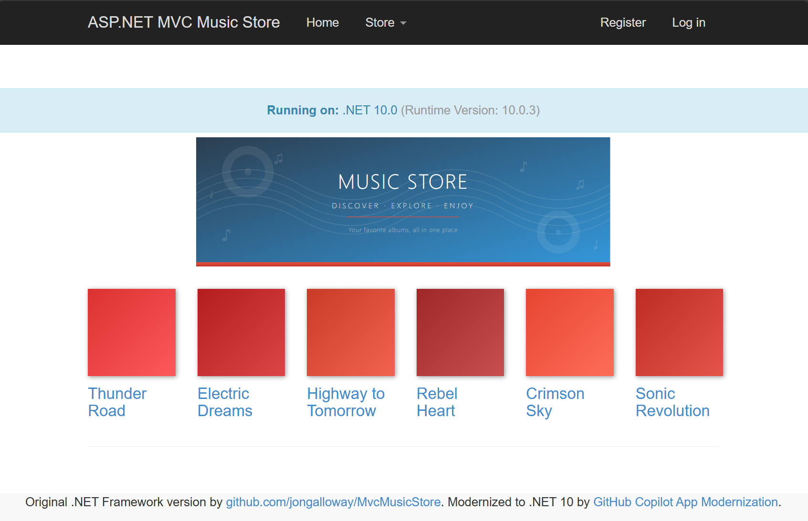

# From "Maybe Next Quarter" to Done Before Lunch: Modernizing a Legacy .NET App with GitHub App Modernization

---

In early 2025, we wanted to modernize Jon Galloway's [MVC Music Store](https://github.com/jongalloway/MvcMusicStore) — a classic ASP.NET MVC 5 app running on .NET Framework 4.8 with Entity Framework 6. The goal was straightforward: move to modern .NET, enable managed identity, and deploy to Azure Container Apps. No more plaintext connection strings. No more passwords in config files.

This was before the GitHub Copilot "Agent" mode. I hit a wall immediately.



Entity Framework on .NET Framework doesn't support `Azure.Identity` or `DefaultAzureCredential`. You can't just add a NuGet package and call it done — you need EF Core, which means you need modern .NET. That means rewriting the data layer, the identity system, the startup pipeline, the views. The engineering team estimated **one week** of dedicated developer work. As a PM without deep .NET migration experience, I couldn't do it quickly myself. The project went on the backlog.

At that time, **GitHub App Modernization** existed but only offered **assessment** — it could tell you *what* needed to change, but couldn't make the changes for you.

Fast-forward one year. The full modernization agent shipped. I sat down with the same app and the same goal. **A few hours later, it was running on Azure Container Apps with managed identity, Key Vault integration, and zero plaintext credentials.** Thank you GitHub Copilot App Modernization https://aka.ms/ghco-appmod!

Here's how it went.

## Deploy this checkout

The repeatable Bicep deployment workflow for this checkout is
`scripts\Deploy-MusicStore.ps1`. The `azd up` discussion below describes the
original modernization experience; use this workflow for the deployment planned
in [DEPLOYMENT_PLAN.md](DEPLOYMENT_PLAN.md).

Prerequisites: PowerShell 7 on Windows, Azure CLI with Bicep, and an interactive `az login`
in the target tenant. The operator needs permission to create resource groups,
resources, and role assignments, and to read their own Entra user profile. The
operator becomes the SQL server's Entra administrator for database bootstrap.
Docker is not required: ACR Tasks builds the Linux image.

Before running commands, copy the shareable `config\azure.example.json` to the
ignored `config\azure.local.json` and fill in your operator-selected subscription,
tenant, resource group, region, and resource/demo references. Never put secret
values in JSON: demo token settings are Key Vault references only.

From the repository root:

```powershell
# Read-only validation and what-if; does not create resources.
.\scripts\Deploy-MusicStore.ps1 -PreviewOnly

# Validate, preview, provision, build, bootstrap SQL, deploy, and check readiness.
.\scripts\Deploy-MusicStore.ps1
```

`scripts\Get-AzureLocalConfig.ps1` returns the parsed configuration object.
Its optional `-ConfigPath` defaults to `config\azure.local.json` at the repository
root. It always validates `schemaVersion` 1 and a subscription GUID, makes no
Azure calls, and never falls back to the account's default subscription.
`-RequiredSettings` accepts a `string[]` of dotted paths, including
`deployment.subscriptionId`, `deployment.tenantId`,
`deployment.resourceGroupName`, `deployment.location`,
`deployment.environmentName`, `resources.containerAppName`,
`resources.applicationUrl`, `resources.registryName`,
`resources.registryEndpoint`, `resources.keyVaultName`,
`demo.healthyRevision`, `demo.candidateRevision`, `demo.candidateVersion`,
`demo.tokenSecretName`, and `demo.tokenSecretVersion`.

`Deploy-MusicStore.ps1` and `Watch-Demo.ps1` automatically load local configuration;
explicit script arguments override corresponding settings, but a valid local
configuration subscription is always required, even with explicit overrides.
Watch uses `-ResourceGroup` and `-AppName` for resource overrides.
All deployed resources are in
the configured group. `src\infra\subscription.bicep` creates the group and invokes
`src\infra\main.bicep`. The new Container Apps environment contains only the
Consumption workload profile, and the app explicitly selects it.

The script uses an HTTPS public-IP lookup for a single-address SQL deployment
firewall rule. Supply `-DeploymentClientIp <IPv4>` if automatic detection does
not match the deployment workstation's SQL egress address. Every Azure CLI
operation explicitly targets the requested subscription; the global default is
not changed.

Infrastructure is provisioned first, without a placeholder app. The script then
builds and pushes an image tagged with a deployment timestamp, pins the deployment
to its immutable image digest, creates a contained
Entra user for the app's managed identity in both databases, and deploys the
actual image through Bicep. Use `-ImageTag <unique-tag>` to select a tag; to resume
with an existing image, use `-SkipImageBuild -ImageTag <existing-tag>`.
Deployment waits for the expected image's revision to be healthy and own 100%
of traffic before checking the public readiness endpoint.
The SQL data-plane grants use the operator's short-lived Entra token, never a
stored SQL password. The app receives database-scoped reader, writer, and DDL
permissions for its startup migrations, not SQL server administrator access.

The app starts in Production with database recreation explicitly disabled,
applies migrations, and seeds only an empty catalog. Startup fails visibly if
initialization fails. `/health/live` checks the process and `/health/ready` checks
both database schemas and the seeded catalog.

Deployment automatically saves returned resource identifiers, including
`resources.applicationUrl`, to ignored local configuration without credentials.
After your first deployment, those outputs are captured locally; run the HTTP
workflow smoke test:

```powershell
.\scripts\Test-MusicStore.ps1
```

This checks browsing, registration, sign-out/sign-in, cart, and checkout. Each
run leaves a synthetic `@example.com` account and order in the demo database;
it does not use real customer information or print the generated password.
`Test-MusicStore.ps1` and `Invoke-DemoTraffic.ps1` automatically load the configured
application URL unless `-ApplicationUrl` is supplied. Loading the configured URL
requires a valid configured subscription. An explicit URL bypasses configuration
loading, allowing local/mock tests without a config file or deliberate invocation
against another target.

Deployment tradeoffs:

- Public HTTPS ingress and authenticated public SQL/Key Vault endpoints are
  intended for this demo, not a private-network production deployment. The SQL
  firewall allows Azure services broadly and the deployment client's IPv4 address.
- The app stays at one replica because sessions are in memory and data-protection
  keys are not externalized. Sessions and sign-in cookies can be lost on restart
  or redeployment. The optional operational demo below uses multiple replicas
  for anonymous catalog requests only; it does not make cart/login workflows
  horizontally scale-ready.
- Consumption does not mean free: the app runs continuously at 0.5 vCPU / 1 GiB.
  ACR Basic, two SQL Basic databases, and monitoring also incur charges.
- Key Vault uses read-only app RBAC, soft delete, and purge protection. SQL is
  Entra-only, ACR admin credentials are disabled, and managed identity is used for
  runtime access.
- The existing dependency set still emits a moderate-severity advisory for
  `OpenTelemetry.Api` 1.12.0 (GHSA-g94r-2vxg-569j), and the login view emits an
  MVC1000 synchronous-partial warning. Deployment does not resolve those
  pre-existing warnings; review them before using this demo in production.

### Operational demo preparation

Prepare healthy and candidate images in an isolated Consumption environment in
your selected region. Keep public traffic pinned to the healthy revision and
stage the candidate at 0% traffic. Update demo revision/version references locally
whenever staging changes them. Record revision names, baked versions, and image
references only in local configuration, not in this README.

A suggested setup uses 0.5 vCPU / 1 GiB per replica, HTTP concurrency target 5,
two to four healthy replicas, and one candidate replica with the same SQL
databases. Warm replicas incur ongoing charges even without demo requests.
Use native `az` commands for builds and staging; the demo scripts do not change
resources.

Demo operations are disabled by default. Enabling them requires both
`Demo__Enabled=true` and `Demo__IsolatedEnvironment=true`, plus a random
32-256-character `Demo__Token`. Configure the app to reference a versioned Key
Vault secret using managed identity. Scope the operator's Secrets Officer
assignment only to that demo secret.
Never print the token, commit it, include it in a URL, or pass it as a script
argument.

Only authenticated synthetic GET requests to `/Store/Browse?genre=Rock` change
behavior: `scale` adds a fixed cancellable 500 ms asynchronous delay before the
normal SQL/MVC action; `release-check` returns an intentional 503 in the candidate
image only; `observe` executes normal browsing. Ordinary requests and probes are
unchanged. Missing/invalid tokens receive 403; disabled operations receive 404.
Authorized responses include version, revision, replica, process UUID/start
time, request trace ID, and active synthetic-request count. The same identities
and run IDs appear in structured logs/traces. There is no HTTP crash endpoint.

PowerShell 7.2+ controls **requests and observation only**:

```powershell
$Config = .\scripts\Get-AzureLocalConfig.ps1 -RequiredSettings deployment.resourceGroupName,resources.containerAppName,demo.healthyRevision
$Subscription = $Config.deployment.subscriptionId
$ResourceGroup = $Config.deployment.resourceGroupName
$App = $Config.resources.containerAppName
$Healthy = $Config.demo.healthyRevision

# Validate the additional references needed for native Azure CLI commands.
$Config = .\scripts\Get-AzureLocalConfig.ps1 -RequiredSettings resources.keyVaultName,demo.tokenSecretName,demo.tokenSecretVersion,resources.registryName,resources.registryEndpoint

# Capture the secret into this terminal only; this does not print its value.
$env:MUSICSTORE_DEMO_TOKEN = az keyvault secret show `
    --subscription $Subscription --vault-name $Config.resources.keyVaultName `
    --name $Config.demo.tokenSecretName --version $Config.demo.tokenSecretVersion `
    --query value --output tsv
if ($LASTEXITCODE -ne 0) { throw 'Cannot read demo credential.' }

# Run in a separate terminal; a compact status screen refreshes in place.
.\scripts\Watch-Demo.ps1

# These commands generate real traffic; run only when ready to demonstrate.
.\scripts\Invoke-DemoTraffic.ps1 -Scenario Scale
.\scripts\Invoke-DemoTraffic.ps1 -Scenario Release
.\scripts\Invoke-DemoTraffic.ps1 -Scenario Recovery

Remove-Item Env:\MUSICSTORE_DEMO_TOKEN
```

Release uses `demo.candidateVersion` unless an explicit `-CandidateVersion` is
supplied. Set it to the baked candidate version, not the revision name.

The request generator never changes Azure resources or crashes a container.
It refreshes a compact traffic screen with concurrency, average completion rate,
latency, explicit error counts, and up to eight responding process identities.
These identity counts are cumulative, not a readiness inventory. Add `-Verbose`
for full identities/bounds or `-NoClear` for scrolling snapshots. Structured
summary objects are returned only with `-PassThru`; JSONL output is unchanged.
The observer shows replica/ready/restart totals, stable short replica labels,
and the four most recent observed changes. `STARTING` means the web container
is not ready; it is not a diagnosis. Add `-Verbose` for full Azure CLI commands
and container IDs, or `-NoClear` for scrolling snapshots instead of a refreshing
screen. Redirected output also uses snapshots. Labels identify replicas, not
process lifetimes; container replacement is shown in recent changes even if the
replica name stays the same.
Defaults: Scale 32 slots/150 seconds; Release 4 slots/up to 10 requests per
second/60 seconds/600 requests; Recovery 8 slots/up to 20 requests per second/
120 seconds/2,000 requests. Hard caps are 64 slots, 180 seconds, 15,000 requests,
and a 15-second individual timeout. Ctrl+C stops owned requests. Optional
`-RunId <slug> -OutputPath <new-file.jsonl>` saves identity/status/latency results
without credentials; existing files are not overwritten. Percentiles use the
latest 2,048 completions. Cookies, redirects, configured retries, and proxy use
are disabled; each HTTP/1.1 connection closes after one request, with a
connection-attempt guard to prevent hidden request replay. Unexpected failures
cause a nonzero exit; candidate 503s are separately counted, not hidden.

Use native Azure CLI for resource changes. For example, build new versions
offstage, using new tags and baked version identifiers each time:

```powershell
$Context = Join-Path $PWD 'src\MvcMusicStore'
$Dockerfile = Join-Path $Context 'Dockerfile'
$BuildId = [DateTime]::UtcNow.ToString('yyyyMMddHHmmss')
$V1 = "ops-v1-$BuildId"
$V2 = "ops-v2-$BuildId"
az acr build --subscription $Subscription --registry $Config.resources.registryName `
    --image "musicstore:$V1" --file $Dockerfile --platform linux/amd64 `
    --build-arg "DEMO_VERSION=$V1" --build-arg DEMO_RELEASE_REGRESSION=false $Context
if ($LASTEXITCODE -ne 0) { throw 'Healthy build failed.' }
az acr build --subscription $Subscription --registry $Config.resources.registryName `
    --image "musicstore:$V2" --file $Dockerfile --platform linux/amd64 `
    --build-arg "DEMO_VERSION=$V2" --build-arg DEMO_RELEASE_REGRESSION=true $Context
if ($LASTEXITCODE -ne 0) { throw 'Candidate build failed.' }

# Existing named traffic must remain pinned before creating another revision.
$Digest = az acr repository show --subscription $Subscription `
    --name $Config.resources.registryName --image "musicstore:$V2" --query digest -o tsv
if ($LASTEXITCODE -ne 0 -or $Digest -notmatch '^sha256:[0-9a-f]{64}$') {
    throw 'Candidate digest lookup failed.'
}
az containerapp revision copy --subscription $Subscription `
    -g $ResourceGroup -n $App --from-revision $Healthy --revision-suffix $V2 `
    --image "$($Config.resources.registryEndpoint)/musicstore@$Digest" `
    --min-replicas 1 --max-replicas 1 --output none
# Verify readiness and direct-revision browsing before changing public traffic.
# Retire unused 0%-traffic revisions explicitly to avoid accumulating warm replicas.
```

Bicep supports `demoEnabled`, `demoIsolatedEnvironment`, `demoTokenSecretUri`,
`demoMinReplicas`, `demoMaxReplicas`, `httpConcurrency`, `revisionMode`,
`revisionSuffix`, `revisionTraffic`, and readiness period/timeout/failure threshold.
Use explicit named `revisionTraffic` in Multiple mode, never `latestRevision`.
The normal defaults remain Single mode/one replica/demo disabled. An enabled
configuration without isolation confirmation and a valid token fails startup.
Demo Bicep readiness defaults are a 5-second period, 3-second timeout, and
2 failures; startup and liveness are unchanged. When using native CLI staging,
configure the complete revision template, including probes; `revision copy`
inherits those probes.

`Deploy-MusicStore.ps1` refuses to overwrite Multiple-mode demo configuration.
To intentionally end the demo, first stop all request generators, then run
`.\scripts\Deploy-MusicStore.ps1 -ResetDemoConfiguration` to deploy a normal image
in Single mode/one replica with demo behavior disabled. It preserves database
data but replaces the demo revision/traffic configuration. The token secret and
its scoped operator assignment remain until explicitly removed.

Focused local checks (no Azure load or faults):

```powershell
dotnet run --project .\tests\DemoOperations.Tests -c Release
dotnet run --project .\tests\DemoOperations.Tests -c Release -p:DemoReleaseRegression=true
.\scripts\Test-DemoUtilities.ps1
.\scripts\Test-AzureLocalConfig.ps1
```

`Test-AzureLocalConfig.ps1` validates missing-configuration refusal without network
access.

---

## Phase 1: Assessment

GitHub App Modernization starts by analyzing your codebase and producing a detailed assessment:

- **Framework gap analysis** — .NET Framework 4.0 → .NET 10, identifying every breaking change
- **Dependency inventory** — Entity Framework 4.1 (not EF Core), MVC 3 references, System.Web dependencies
- **Security findings** — plaintext SQL connection strings in `Web.config`, no managed identity support
- **API surface changes** — `Global.asax` → `Program.cs` minimal hosting, `System.Web.Mvc` → `Microsoft.AspNetCore.Mvc`

The assessment is not a generic checklist. It reads your code — your controllers, your `DbContext`, your views — and maps a concrete migration path. For this app, the key finding was clear: EF 4.1 on .NET Framework cannot support `DefaultAzureCredential`. The *entire* data layer needs to move to EF Core on modern .NET to unlock passwordless authentication.

## Phase 2: Code & Dependency Modernization

This is where last year's experience ended and this year's began. The agent performed the actual migration:

**Project structure:**
- `.csproj` converted from legacy XML format to SDK-style targeting `net10.0`
- `Global.asax` replaced with `Program.cs` using minimal hosting
- `packages.config` → NuGet `PackageReference` entries

**Data layer (the hard part):**
- Entity Framework 4.1 → EF Core with `Microsoft.EntityFrameworkCore.SqlServer`
- `DbContext` rewritten with `OnModelCreating` fluent configuration
- `System.Data.Entity` → `Microsoft.EntityFrameworkCore` namespace throughout
- EF Core migrations generated from scratch
- Database seeding moved to a proper `DbSeeder` pattern with `MigrateAsync()`

**Identity:**
- ASP.NET Membership → ASP.NET Core Identity with `ApplicationUser`, `ApplicationDbContext`
- Cookie authentication configured through `ConfigureApplicationCookie`

**Security (the whole point):**
- `Azure.Identity` + `DefaultAzureCredential` integrated in `Program.cs`
- Azure Key Vault configuration provider added via `Azure.Extensions.AspNetCore.Configuration.Secrets`
- Connection strings use `Authentication=Active Directory Default` — no passwords anywhere
- Application Insights wired through OpenTelemetry

**Views:**
- Razor views updated from MVC 3 helpers to ASP.NET Core Tag Helpers and conventions
- `_Layout.cshtml` and all partials migrated

The code changes touched every layer of the application. This is not a find-and-replace — it's a structural rewrite that maintains functional equivalence.

## Phase 3: Local Testing

After modernization, the app builds, runs locally, and connects to a local SQL Server (or SQL in a container). EF Core migrations apply cleanly, the seed data loads, and you can browse albums, add to cart, and check out. The identity system works. The Key Vault integration gracefully skips when `KeyVaultName` isn't configured — meaning local dev and Azure use the same `Program.cs` with zero code branches.

## Phase 4: `azd up` and Deployment to Azure

The agent also generates the deployment infrastructure:

- **`azure.yaml`** — AZD service definition pointing to the `Dockerfile`, targeting Azure Container Apps
- **`Dockerfile`** — Multi-stage build using `mcr.microsoft.com/dotnet/sdk:10.0` and `aspnet:10.0`
- **`infra/main.bicep`** — Full IaC including:
  - Azure Container Apps with system + user-assigned managed identity
  - Azure SQL Server with **Azure AD-only authentication** (no SQL auth)
  - Azure Key Vault with RBAC, Secrets Officer role for the managed identity
  - Container Registry with ACR Pull role assignment
  - Application Insights + Log Analytics
  - All connection strings injected as Container App secrets — using `Active Directory Default`, not passwords

One command:

```bash
azd up
```

Provisions everything, builds the container, pushes to ACR, deploys to Container Apps. The app starts, runs `MigrateAsync()` on first boot, seeds the database, and serves traffic. Managed identity handles all auth to SQL and Key Vault. No credentials stored anywhere.

---

## What Changed in a Year

| | Early 2024 | Mid 2025 |
|---|---|---|
| **Assessment** | ✅ Available | ✅ Available |
| **Automated code modernization** | ❌ Not yet | ✅ Full migration agent |
| **Target framework** | .NET 8 | .NET 10 |
| **EF Core managed identity support** | Available but manual migration required | Agent handles the full EF → EF Core rewrite |
| **Infrastructure generation** | ❌ Manual | ✅ Bicep + AZD generated |
| **Time to complete** | ~1 week (senior developer) | ~Few hours (PM, no deep .NET experience) |

The technology didn't just improve incrementally. The gap between "assessment" and "done" collapsed. A year ago, knowing *what* to do and *being able to do it* were very different things. Now they're the same step.

---

## Who This Is For

If you have a .NET Framework app sitting on a backlog because "the migration is too expensive" — revisit that assumption. The cost changed. GitHub App Modernization doesn't just tell you what's wrong. It rewrites your data layer, generates your infrastructure, and gets you to `azd up`. The hardest part of this modernization — EF to EF Core with managed identity — is exactly the part the agent handles end to end.

MVC Music Store went from .NET Framework 4.0 with Entity Framework 4.1 and plaintext SQL credentials to .NET 10 on Azure Container Apps with managed identity, Key Vault, and zero secrets in code. In an afternoon.

That backlog item might be a lunch break now.
